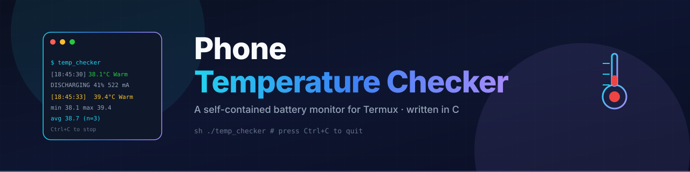

<div align="center">

# 🌡️ Phone Temperature Checker

### A self-contained battery temperature monitor for Termux, written in C.



[-22D3EE?style=for-the-badge&logo=android&logoColor=white)](https://f-droid.org/en/packages/com.termux/)
[](#technologies-used)
[](#technologies-used)
[](LICENSE)

Read your phone's **battery temperature, charge level, status and current draw**
from the terminal — **color-coded**, with **running statistics**, in a single file.

</div>

---

## ✨ Features

- 🔥 **Live battery temperature** in °C, refreshed every 3 seconds
- 🔋 **Battery level** (percentage) and **charging status** (DISCHARGING / CHARGING / FULL …)
- ⚡ **Current draw** in mA, sign-normalised via `fabs()`
- 🎨 **Color-coded thresholds** — Green / Yellow / Orange / Red with safety labels
- 📊 **Session statistics** — min / max / average temperature and sample count
- 🕒 **Timestamped readings** for trend tracking
- 🛠 **Self-bootstrapping** — shell wrapper embeds the C source, compiles on first run
- ♻️ **Smart rebuild** — only recompiles when the script is newer than the cached binary
- 🧹 **Clean shutdown** — `sigaction`-based Ctrl+C handler, async-signal-safe
- 📦 **Single file** — no Makefile, no external JSON library, no config

---

## 🤔 Why this project exists

Android exposes battery temperature to system apps but not to the shell. The
only clean way to read it from a terminal is through the
**Termux:API companion app**, which wraps Android's `BatteryManager` and prints
JSON on stdout.

This project is a **tiny, dependency-free C program** that:

1. Calls `termux-battery-status` every 3 seconds
2. Parses the JSON with two handwritten helpers (no `cJSON` / no `jansson`)
3. Prints a single color-coded line with running min/max/avg

It also solves a **FUSE execution quirk** on Android: pre-compiled binaries
can't be `execve`'d directly from the Android Workspace mount, so the project
ships as a **shell script that compiles the embedded C source** to
`$HOME/.cache/temp_checker/` on first run.

---

## 📸 Screenshots

> Add a real screenshot of the program running, then link it here.

| Live monitoring | Critical warning |
|---|---|
| _placeholder_ | _placeholder_ |

---

## 📋 Requirements

> [!IMPORTANT]
> You **MUST** use the **F-Droid** build of Termux. The Google Play Store
> version is outdated and incompatible with current `termux-api` packages.

| Requirement | Why | Install |
|---|---|---|
| **Termux (F-Droid)** | Runtime environment | [f-droid.org/en/packages/com.termux](https://f-droid.org/en/packages/com.termux/) |
| **Termux:API (F-Droid app)** | Provides `termux-battery-status` | [f-droid.org/en/packages/com.termux.api](https://f-droid.org/en/packages/com.termux.api/) |
| **termux-api (package)** | Client-side binaries in `$PREFIX/bin` | `pkg install termux-api` |
| **clang** | C compiler used by the wrapper | `pkg install clang` |
| **ARM64 Android device** | Cached binary is built natively | All modern devices |

---

## 🚀 Installation

### Step 1 — Install Termux
Download **Termux** from **F-Droid** (not the Play Store):
👉 https://f-droid.org/en/packages/com.termux/

### Step 2 — Install Termux:API
Download the **Termux:API** Android app from F-Droid:
👉 https://f-droid.org/en/packages/com.termux.api/

Open it **once** to register the IPC service. You don't need to interact with it.

### Step 3 — Install the Termux packages
Open Termux and run:
```bash
pkg update && pkg upgrade
pkg install clang termux-api
```

### Step 4 — Verify the battery API
```bash
termux-battery-status
```
You should see JSON like:
```json
{ "health": "Good", "percentage": 41, "plugged": "UNPLUGGED",
  "status": "DISCHARGING", "temperature": 38.1, "current": -522000 }
```

### Step 5 — Place the script
Copy `temp_checker` anywhere — `$HOME`, `/sdcard`, or the Android Workspace.
No build step is required; the script compiles itself on first run.

---

## ▶️ Usage

```bash
sh /path/to/temp_checker
```

> [!NOTE]
> The `sh` prefix is **required** when running from a FUSE mount such as the
> Android Workspace or `/sdcard`, because the kernel blocks direct `execve()`
> from those paths. From `$HOME` you can also run `./temp_checker` directly.

Press **Ctrl+C** to stop.

---

## 🧪 Example session

```
============================================
   Phone Temperature Checker  (Ctrl+C = quit)
============================================
  Refreshing every 3 seconds. Press Ctrl+C to stop.

[18:45:30]  38.1°C  Warm  |  DISCHARGING  |  41%  |  522 mA
[18:45:33]  38.1°C  Warm  |  DISCHARGING  |  41%  |  519 mA  |  min 38.1  max 38.1  avg 38.1  (n=2)
[18:45:36]  39.4°C  Warm  |  DISCHARGING  |  41%  |  488 mA  |  min 38.1  max 39.4  avg 38.5  (n=3)
[18:45:39]  42.7°C  Hot - close heavy apps!  |  DISCHARGING  |  40%  |  601 mA
```

### Temperature thresholds

| Color | Range | Label | Action |
|---|---|---|---|
| 🟢 Green | < 35 °C | `Normal` | All good |
| 🟡 Yellow | 35 – 40 °C | `Warm` | Light use is fine |
| 🟠 Orange | 40 – 45 °C | `Hot - close heavy apps!` | Drop brightness, switch to Wi-Fi |
| 🔴 Red | > 45 °C | `CRITICAL - let it cool down!` | Stop heavy tasks, let it cool |

---

## 📁 Project structure

```
.
├── temp_checker              # Single file: sh wrapper + embedded C source
├── README.md                 # This file
├── GUIDE.md                  # Full internals & troubleshooting guide
├── LICENSE                   # MIT License
└── assets/
    ├── banner.svg            # README header
    ├── social-preview.svg    # GitHub social preview
    ├── icons/                # 64×64 icon set
    └── illustrations/        # 800×400 diagrams
```

The repo contains **no pre-compiled binary**. The wrapper builds on first run
and caches the result at `$HOME/.cache/temp_checker/`.

---

## 🧰 Technologies used

| Layer | Technology | Role |
|---|---|---|
| Wrapper | POSIX `sh` | Build orchestration, cache management |
| Core | C (C99) | Battery polling, parsing, terminal output |
| IPC | `termux-battery-status` | Bridge to Android `BatteryManager` |
| Build | `clang -O2 -Wall -Wextra` | Compilation with strict warnings |
| Color | ANSI escape codes | Terminal coloring |

---

## ⚙️ How it works

```
┌─────────────┐   popen()   ┌──────────────────────┐   IPC   ┌────────────┐
│ temp_checker│ ──────────► │ termux-battery-status│ ──────► │  Termux:API │
│   (C code)  │ ◄────────── │       (JSON)         │ ◄────── │   (app)    │
└─────────────┘   parse     └──────────────────────┘         └────────────┘
       │                                                            │
       ▼                                                            ▼
   print line                                              Android BatteryManager
   every 3 s                                               (system service)
```

Read the full internals walkthrough in **[GUIDE.md → How It Works](GUIDE.md)**.

---

## 🛠 Troubleshooting

| Symptom | Likely cause | Fix |
|---|---|---|
| `termux: not found` | Not running inside Termux | Open Termux, then run the script |
| `permission denied` | Ran directly from FUSE mount | Use `sh /path/to/temp_checker` |
| `Could not read battery info.` | Termux:API app missing or killed | Install Termux:API from F-Droid, open it once, disable battery optimisation for it |
| `read failed (API app stopped?)` mid-session | Android killed Termux:API in background | Disable battery optimisation for the Termux:API app |
| `clang: not found` | Compiler not installed | `pkg install clang` |
| Temperature looks "stuck" | Android's `BatteryManager` reports low resolution | OS-level limitation, not a bug |

---

## ❓ FAQ

**Q: Why not pre-compile and ship a binary?**
A: FUSE mounts (Android Workspace, `/sdcard`) block `execve()`. The wrapper
compiles to `$HOME` where execution works.

**Q: Why no JSON library?**
A: The schema is tiny and known. Two `strstr()`-based helpers handle it in
under 30 lines.

**Q: Why is current always positive?**
A: Android reports it in signed microamps (negative = leaving the battery).
The program shows the magnitude plus a separate status string.

**Q: Does this need root?**
A: No. `termux-battery-status` requires no Android permission.

**Q: Will this work on the Play Store version of Termux?**
A: Probably not. The Play Store build is deprecated. Use **F-Droid**.

**Q: Can I run it from Termux widget / Tasker?**
A: Yes — invoke `sh /path/to/temp_checker` from any automation tool.

---

## 🔭 Future improvements

- CLI flags: `--interval 5`, `--no-color`, `--csv log.csv`
- Configurable alert threshold with `termux-notification` and `termux-vibrate`
- Optional `NO_COLOR=1` support
- Optional sparkline of the last N readings
- Optional CPU temperature on rooted devices (`/sys/class/thermal/`)
- Auto-rebuild when `clang` major version changes

---

## 🤝 Contributing

Contributions are welcome. Please:

1. Fork the repository
2. Create a feature branch (`git checkout -b feature/my-change`)
3. Keep the project **single-file** if possible
4. Run `clang -Wall -Wextra -O2` and confirm zero warnings
5. Open a Pull Request with a clear description

---

## 📜 License

Released under the **[MIT License](LICENSE)** — free for personal,
educational, and commercial use, modification and redistribution,
with attribution.

```
Copyright (c) 2026 Shyam
```

---

## 🙏 Credits

- **[Termux](https://termux.dev/)** and **[Termux:API](https://github.com/termux/termux-api)** — the only reason this project can read battery info from a shell.
- **Android `BatteryManager`** — the system service that ultimately reports the data.
- The C standard library — `popen`, `strtod`, `strstr`, `sigaction`. No third-party C libraries.
